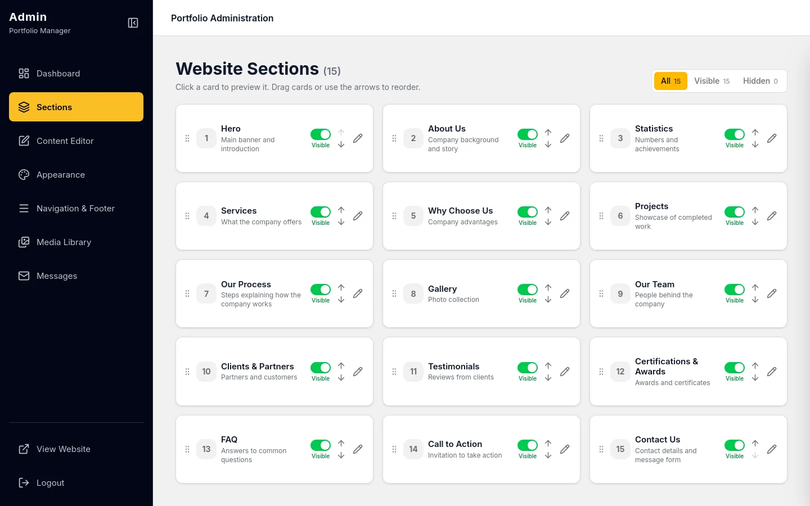
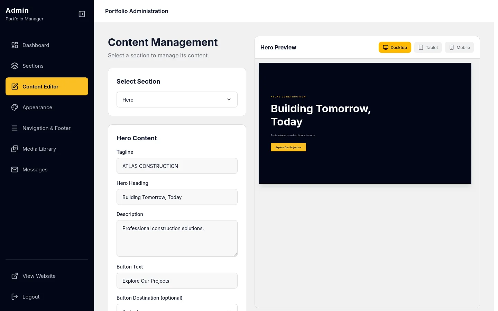
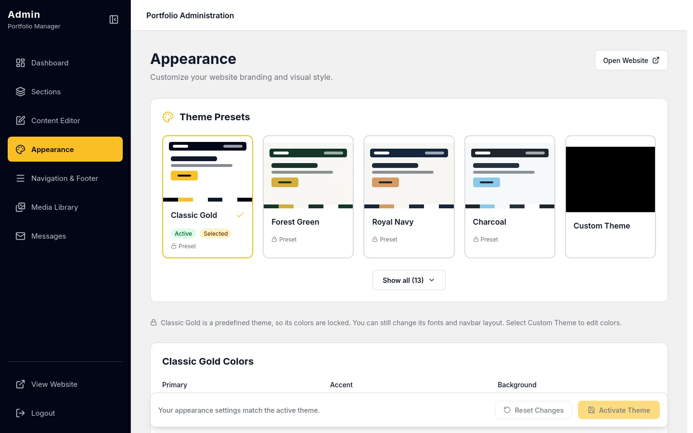
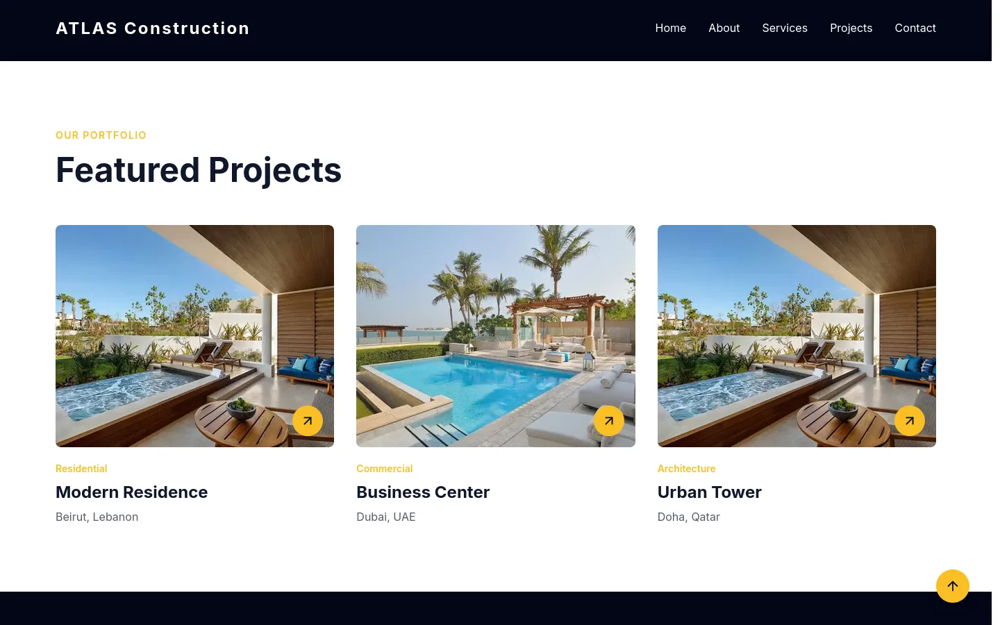

# Flexible Portfolio — Configurable Company Website with an Admin Dashboard


Flexible Portfolio is a full-stack company website whose sections, content and theme are all managed from an admin dashboard. Administrators choose and reorder 15 section types, edit their content next to a live preview, pick or customise a theme, and manage navigation, social links, services, projects, media and contact messages. The public site shows the result.

The system includes a Next.js website that also serves as the admin backend-for-frontend, an ASP.NET Core Web API, a MySQL database, and local media storage.

---

## Project Overview

Small companies often need a website they can update themselves, without a developer for every text change, new project or colour tweak. Template site builders are either too rigid or too complex for that.

Flexible Portfolio solves this by turning every part of the site into editable, validated content:

- Section-based page building from 15 section types
- Show, hide and drag to reorder sections
- Content editing with a live desktop, tablet and mobile preview
- Theme presets and a custom theme
- Navigation and social link management
- Services and projects catalog with project detail pages
- Media library for uploaded images
- Contact form with an admin inbox
- Automatic regeneration of the public site after every save

---

## Project Status

The system is complete as a working full-stack product and runs locally. It includes the public website, the admin dashboard, the backend API, database migrations, seed data, authentication, authorization, CSRF protection and rate limiting.

There is no automated test suite yet. `dotnet build`, `tsc` and `eslint` are the current checks.

---

## Main Users

| User Role | Description |
|---|---|
| Administrator | Signs in to the admin dashboard and manages sections, content, appearance, navigation, services, projects, media and contact messages |
| Visitor | Browses the public website, opens project pages and sends messages through the contact form |

---

## Tech Stack

### Backend

- ASP.NET Core 10 Web API
- C#
- Entity Framework Core
- MySQL 8
- Cookie authentication
- ASP.NET Core password hasher
- Role-based authorization
- Built-in rate limiting
- OpenAPI document in Development

### Frontend

- Next.js 16 (App Router)
- React 19
- TypeScript
- Tailwind CSS 4
- Zod
- Axios
- Lucide icons

### Database and Storage

- MySQL
- Local file storage for uploaded images (`backend/wwwroot/uploads`)

---

## Main Features

### Admin Features

- Sign in with a session cookie
- View dashboard statistics
- Show, hide and drag to reorder sections
- Edit section content with a live preview on desktop, tablet and mobile
- Switch between 12 theme presets or build a custom theme
- Manage the brand: company name, logo, favicon, contact details, footer text and SEO title and description
- Manage navigation links and social links
- Manage company services and projects
- Upload and manage images in the media library
- Read and manage contact messages

### Public Website Features

- Home page built from the visible sections, in the admin's order
- Project detail pages at `/projects/[slug]`
- Contact form, rate-limited per visitor
- Active theme applied across the whole site

### Section Types

| Group | Section types |
|---|---|
| Intro | `hero`, `about`, `stats` |
| Offer | `services`, `projects`, `whyChooseUs`, `process` |
| Proof | `gallery`, `team`, `clients`, `testimonials`, `certifications` |
| Action | `faq`, `cta`, `contact` |

Each type has a typed content shape validated on both sides: Zod schemas in the frontend and `SectionContentValidator` in the backend. Full field lists are in [`API.md`](API.md#section-content-types).

---

## System Architecture

```text
Visitor Browser
      |
      v
Next.js Website (public pages, prerendered)
      |
      | Axios
      v
ASP.NET Core Backend API
      |
      | EF Core
      v
MySQL Database

Admin Browser
      |
      v
Next.js Admin Dashboard + BFF (/api/admin, /api/auth)
      |
      | Session cookie forwarded server-side
      v
ASP.NET Core Backend API

Backend Layers:
Controller → Service → EF Core → MySQL

Media Flow:
Admin uploads image → API saves file to wwwroot/uploads → MediaAsset row in MySQL → served under /uploads
```

---

## Main Workflow

```text
Administrator signs in
→ Next.js BFF forwards the request to the API
→ API sets the HttpOnly session cookie
→ Administrator edits a section next to the live preview
→ Frontend validates the content with Zod
→ API validates it again and checks for conflicting edits
→ Content is saved in MySQL
→ Next.js regenerates the public pages
→ Visitors see the update
```

---

## Authentication and Authorization

Flexible Portfolio uses cookie-based authentication for administrators.

After login:

```text
Backend verifies credentials
→ Backend sets the portfolio_admin cookie
→ Next.js BFF forwards the cookie on admin requests
→ Backend validates the cookie and the Admin role
```

The admin cookie is:

- `HttpOnly`, so page scripts cannot read it
- `SameSite=Lax`
- `Secure` outside Development
- Valid for 8 hours, with no sliding expiration

Additional protections:

- Every `/api/admin/**` route requires the `Admin` role. This is applied by a route convention and verified at startup, so a new controller cannot forget it.
- Admin writes are rejected unless their `Origin` header is in `Cors:AllowedOrigins`, which blocks cross-site requests (CSRF).
- Content the admin may have loaded a while ago is saved with optimistic concurrency: a stale save returns `409 Conflict` instead of overwriting someone else's edit.
- Login is limited to 10 attempts and the contact form to 5 messages per 15 minutes per IP.
- Passwords are hashed with the ASP.NET Core password hasher.

---

## Project Structure

```text
Flexible Portfolio
├── backend
│   ├── Controllers
│   │   └── Admin
│   ├── Services
│   ├── Models
│   ├── DTOs
│   ├── Data
│   │   └── Seeders
│   ├── Middleware
│   ├── Migrations
│   └── wwwroot
│       └── uploads
│
├── frontend
│   └── src
│       ├── app
│       │   ├── admin
│       │   ├── api
│       │   └── projects
│       ├── components
│       ├── lib
│       ├── schemas
│       └── types
│
├── screenshots
└── API.md
```

---

## Screenshots

### Sections Manager



### Content Editor with Live Preview



### Appearance and Themes



### Public Website



---

## API Documentation

See [`API.md`](API.md) for the full endpoint reference: the public content API, auth, admin CRUD, the 15 section content shapes, the error format and rate limits.

A generated OpenAPI document is also served at `/openapi/v1.json` while the API runs in Development.

---

## Prerequisites

Before running the project locally, make sure you have:

- .NET 10 SDK installed
- Node.js 20+ and npm installed
- MySQL 8 running
- The `dotnet-ef` tool (`dotnet tool install -g dotnet-ef`)

---

## Setup Instructions

### Backend Setup

1. Create an empty MySQL database and a user with full rights on it.
2. Give the API its connection string (do not commit it):

   ```bash
   cd backend
   dotnet user-secrets set "ConnectionStrings:DefaultConnection" "Server=127.0.0.1;Port=3306;Database=<db>;User=<user>;Password=<password>;"
   ```

3. Create the tables:

   ```bash
   dotnet ef database update
   ```

4. Load the starter data, in this order. Each command seeds once and exits. Media must come before services and projects, and sections before navigation and section content:

   ```bash
   for s in media sections site-settings themes company-services projects navigation social-links section-content; do
     dotnet run -- --seed-$s
   done
   ```

5. Create the first administrator (Development only; the password needs 12+ characters):

   ```bash
   ADMIN_FULL_NAME="Your Name" ADMIN_EMAIL="you@example.com" ADMIN_PASSWORD="<password>" \
     dotnet run -- --seed-admin
   ```

6. Start the API:

   ```bash
   dotnet run --launch-profile http
   ```

Backend runs on:

```text
http://localhost:5271
```

### Frontend Setup

```bash
cd frontend
npm install
npm run dev
```

Frontend runs on:

```text
http://localhost:3000        (public website)
http://localhost:3000/admin  (admin dashboard)
```

---

## Environment Variables

Real secrets are not committed to this repository.

### Backend

Use `.NET User Secrets` locally and environment variables in production.

| Setting | Required | Description |
|---|---|---|
| `ConnectionStrings:DefaultConnection` | Yes | MySQL connection string (`ConnectionStrings__DefaultConnection` as an environment variable) |
| `Cors:AllowedOrigins` | No | Array of website origins allowed to call the API and to write to admin routes. Default `http://localhost:3000` |
| `ForwardedHeaders:KnownProxies` | No | Array of reverse proxy IP addresses trusted to report the visitor's IP |

### Frontend

Create `frontend/.env.local`:

```env
API_BASE_URL=http://localhost:5271
NEXT_PUBLIC_API_BASE_URL=http://localhost:5271
# TRUST_PROXY_HEADERS=true   # only behind a reverse proxy that adds the visitor's address
```

`API_BASE_URL` is used by the Next.js server. `NEXT_PUBLIC_API_BASE_URL` is used by the browser for the public contact form.

---

## Checks

```bash
cd backend && dotnet build
cd frontend && npx tsc --noEmit && npx eslint . && npm run build
```

Testing is manual: run both apps and exercise the admin dashboard and the public site.

---

## Deployment Notes

- **`npm run build` needs the API running** (and `API_BASE_URL` set): the home page is prerendered at build time. After an admin saves, the page is regenerated automatically. Admin pages and admin API responses are never cached.
- **HTTPS is required** outside Development, because the admin cookie is `Secure` there.
- **ASP.NET Data Protection keys are not persisted.** Configure a shared, persistent key location (`PersistKeysTo...`), or every restart (or a second instance) logs the admins out.
- **Rate limits** are built in and kept in memory. The visitor's IP is only believed from trusted proxies:
  - API: loopback plus the addresses in `ForwardedHeaders:KnownProxies`. If a reverse proxy sits in front of the API, add it there, otherwise every visitor shares one limit.
  - Next.js: set `TRUST_PROXY_HEADERS=true` only if a reverse proxy in front of Next.js adds the visitor's address to `X-Forwarded-For` (the last entry is used). Without it, all admin logins share one limit, which is safe but coarse.
- Set `Cors:AllowedOrigins` to the production website origin. It also limits cross-site admin writes.
- Uploaded images are stored in `backend/wwwroot/uploads` and must be kept (volume or backup). The images committed there are seed and demo images.
- Admin accounts can only be created with `--seed-admin`, which is disabled outside Development.

---

## Security Note

Real secrets, database passwords and local environment files are not committed to this repository.

Private values should be stored locally using `.NET User Secrets` and `.env.local`, and in production as deployment environment variables.

---

## Future Improvements

- Deploy the website and API online
- Add an automated test suite
- Persist Data Protection keys for multi-instance hosting
- Add password reset and password change for administrators
- Add administrator management from the dashboard
- Move media storage to cloud object storage
- Add multi-language content

---

## Author

Sami Farhat  
Computer Science Graduate  
GitHub: [SF-47](https://github.com/SF-47)  
Repository: [Flexible Portfolio](https://github.com/SF-47/flexible-portfolio)  
LinkedIn: [samifarhat-dev](https://www.linkedin.com/in/samifarhat-dev)
